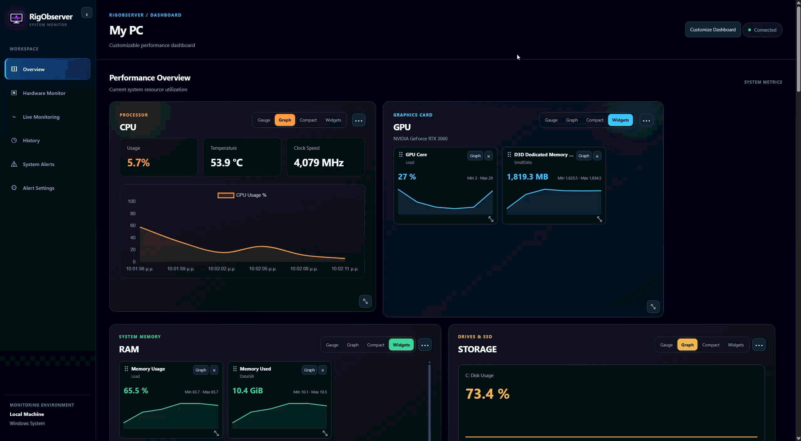
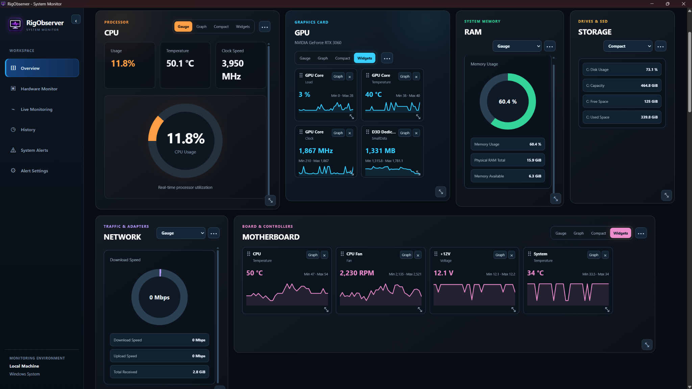
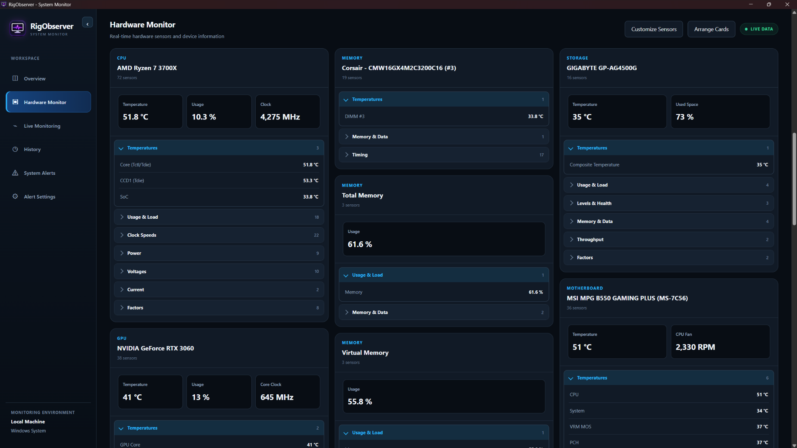
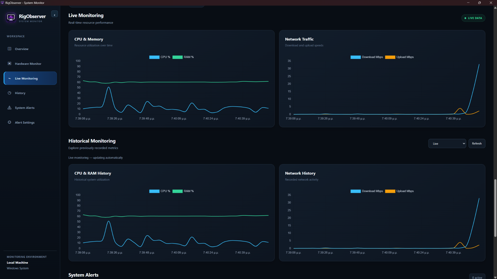

# RigObserver

**Real-time PC hardware and system monitoring for Windows**

## Live Demo



[**Download for Windows (v0.1.0)**](https://github.com/KostasNikP/RigObserver/releases/download/v0.1.0/RigObserver_Setup_v0.1.0.exe) · [Latest release](https://github.com/KostasNikP/RigObserver/releases/tag/v0.1.0)

RigObserver is a local desktop application for monitoring CPU, GPU, RAM, storage, network activity, and motherboard sensors. It combines a configurable performance dashboard with live hardware readings, alerts, and historical system metrics.

Built with **Python, FastAPI, pywebview (WebView2), C# / .NET 10, LibreHardwareMonitor, and JavaScript**.

## Screenshots

Actual screenshots of the RigObserver Windows desktop application.

### Performance Overview

A customizable dashboard with dedicated CPU, GPU, RAM, Storage, Network, and Motherboard monitoring cards. Mix gauges, compact readings, graphs, and individual sensor widgets to suit your workflow.



### Hardware Monitor

Explore detected hardware, current sensor readings, temperature and usage data, and expandable sensor categories.



### Live Monitoring

Track CPU, memory, and network activity with real-time and historical performance charts.



## Features

### Performance Overview

- Six groups: **CPU, GPU, RAM, Storage, Network, and Motherboard**.
- Choose **Gauge**, **Graph**, **Compact**, or **Widgets** for each group.
- Resize parent cards freely and retain their individual dimensions.
- Reorder the six main dashboard cards by dragging their handles, or use Move earlier / Move later; card order is saved locally.
- Choose **Smart Layout** to automatically pack cards into available space, or **Free Layout** to drag cards to any position with optional gaps.
- Keep Free positions and Smart card order independently between launches; reset Free positions without deleting sensor settings.
- Free Layout automatically avoids card overlaps when opening/collapsing the sidebar, resizing the window, or dragging a card over another; stored positions are preserved when only the workspace width changes.
- Add or hide sensor mini-widgets; change their order, size, and display format.
- Choose **Auto** or **Free** widget arrangement.
- Save layout preferences between application launches.
- Compact, collapsible sidebar and contextual card options.

### Hardware Monitor

- Discover supported hardware automatically rather than relying on a specific CPU or GPU model.
- Display available temperatures, loads, clocks, fan speeds, voltages, power readings, and other sensors.
- Arrange device cards, hide and restore groups, and use a **Basic** layout preset.
- Search for and selectively display sensor readings.
- Use a separately authorized administrator helper to access additional sensors where supported.

Hardware availability varies by machine, drivers, permissions, and sensors exposed by LibreHardwareMonitor.

### System Monitoring and Alerts

- Live CPU, memory, disk, and upload/download activity.
- Historical usage records stored in a local SQLite database.
- Configurable CPU, RAM, and disk usage thresholds.
- Alerts after three consecutive readings at or above a threshold.
- Local FastAPI endpoints and interactive documentation at `/docs`.

## Windows Desktop Application

The Windows build uses **pywebview / Microsoft Edge WebView2** and includes a Python backend and a hardware sensor bridge.

**Requirements for the packaged application:**
- Windows x64.
- Microsoft Edge WebView2 Runtime.
- Administrator permission is optional for additional hardware sensor access.

The packaged version does **not** require installing Python or the .NET SDK separately.

### Download and installation

1. Download [**RigObserver_Setup_v0.1.0.exe**](https://github.com/KostasNikP/RigObserver/releases/download/v0.1.0/RigObserver_Setup_v0.1.0.exe) from the [official v0.1.0 release](https://github.com/KostasNikP/RigObserver/releases/tag/v0.1.0).
2. Run the installer and follow the Windows setup wizard.
3. Launch **RigObserver** from the Start menu (or a desktop shortcut, if selected during installation).

Windows may display an unrecognized publisher warning because the installer is not code-signed.

### Your existing settings

The Windows application currently keeps using the legacy **`%LOCALAPPDATA%\PulseWatch\data`** directory, including WebView storage, to preserve saved dashboards and other data when upgrading from PulseWatch. The existing `pulsewatch_*` localStorage keys are intentionally retained for compatibility; these internal identifiers do not change the RigObserver branding.

## Development Setup

### Prerequisites

- Windows and Python 3 with `venv` and `pip` (developed with Python 3.14).
- .NET 10 SDK for building the sensor bridge.
- Internet access to install dependencies and access the Chart.js CDN used by the dashboard.

Clone the repository:

```powershell
git clone https://github.com/KostasNikP/RigObserver.git
cd RigObserver
```

Run **`setup_rigobserver.bat`** to create `.venv`, install Python dependencies, and build the development sensor bridge. Then start the desktop application:

```powershell
.\.venv\Scripts\python.exe -m app.desktop
```

For the browser-based dashboard, run **`start_rigobserver.bat`**, or start the API directly:

```powershell
.\.venv\Scripts\python.exe -m uvicorn app.api:app --host 127.0.0.1 --port 8000
```

Open <http://127.0.0.1:8000/dashboard>. Starting only Uvicorn will not automatically launch the elevated sensor helper.

### Build the Windows executable

The release build uses `RigObserver.spec` and a published Windows sensor bridge binary. From the repository root:

```powershell
dotnet publish .\sensor_bridge\sensor_bridge.csproj -c Release -r win-x64 --self-contained true
.\.venv\Scripts\python.exe -m pip install pyinstaller
.\.venv\Scripts\python.exe -m PyInstaller --noconfirm --clean RigObserver.spec
```

The compiled application is created in `dist\RigObserver\RigObserver.exe`.

To package an installer, open **`RigObserver.iss`** in Inno Setup 6 and choose **Build → Compile**. The expected installer path is `installer\RigObserver_Setup_v0.1.0.exe`.

The `.spec` file expects `sensor_bridge\bin\Release\net10.0\win-x64\publish\sensor_bridge.exe` to exist before packaging. Install Inno Setup separately when building the installer.

## REST API

| Method | Endpoint | Purpose |
| --- | --- | --- |
| GET | `/` | API status |
| GET | `/dashboard` | Dashboard UI |
| GET | `/api/system` | CPU, RAM, and disk metrics |
| GET | `/api/network` | Network counters and speeds |
| GET | `/api/metrics` | Combined live metrics and alerts |
| GET | `/api/hardware` | Hardware inventory |
| GET | `/api/sensors` | Live hardware sensor snapshot |
| GET | `/api/history` | Historical system metrics |
| GET | `/api/alerts` | Current usage alerts |
| GET / PUT | `/api/alert-settings` | Alert thresholds |
| GET | `/docs` | Interactive API documentation |

Readings may initially be unavailable while background monitoring starts. History queries accept `limit` and `since` parameters.

## Project Structure

```text
app/
  api.py                  FastAPI routes
  desktop.py              Windows desktop startup
  collector.py            Background monitoring
  admin_sensor_helper.py  Optional privileged sensor collector
  paths.py                Runtime data paths
  static/                 HTML, CSS, JavaScript, and RigObserver UI icon
sensor_bridge/            C# hardware bridge (LibreHardwareMonitor)
assets/RigObserver.ico    Windows application icon
RigObserver.spec          PyInstaller configuration
RigObserver.iss           Inno Setup installer configuration
setup_rigobserver.bat     Development environment setup
start_rigobserver.bat     Browser dashboard launcher
requirements.txt
README.md
```

## Security and Limitations

- The API is intended for **local use** and has no user authentication. Do not expose it to the public internet; keep it bound to `127.0.0.1`.
- Elevated hardware monitoring uses an administrator-approved helper and local sensor snapshots.
- Some sensors may be missing or inaccurate depending on supported hardware.
- Network speeds represent observed data transfer, not the maximum internet connection speed.
- Internet access may be needed for charts because Chart.js is currently loaded from a CDN.
- The Windows installer is not presently described as code-signed; Windows security prompts may appear.

## Author

**Konstantinos Nikolakopoulos**  
Computer Science & Telecommunications Graduate

[GitHub profile](https://github.com/KostasNikP)
